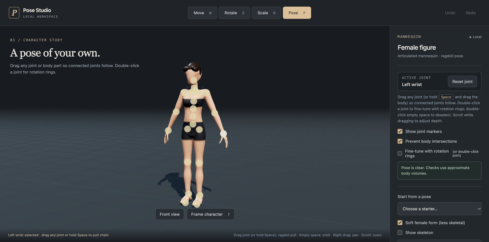

# ArtCraft Pose Studio

A friendly, **local-first** 3D pose studio that runs in your browser. Grab a joint on the
articulated mannequin, drag it, and the rest of the body follows like a ragdoll. Nothing is
uploaded anywhere.



## Features

- **Drag to pose:** pull any joint (or hold <kbd>Space</kbd> and drag the body) and connected joints follow.
- **Fine-tune:** double-click a joint for rotation rings, or use Move / Rotate / Scale for the whole figure.
- **Safe poses:** optional body-intersection checks and relaxed default hands.
- **Undo / redo**, reset, framing, front view and snapping.
- **Save and load poses** as JSON, **download the posed model** as a GLB, or **render an image**.
- **Headless CLI** for scripted posing (see below).

## Quick start

You only need Python 3 (for a tiny static server) and a modern browser.

```bash
python3 -m http.server 8010 --bind 127.0.0.1
# then open http://127.0.0.1:8010/
```

Saved poses, models and renders go to your browser's download folder.

### Keyboard and mouse

| Action | Control |
| --- | --- |
| Move / Rotate / Scale / Pose mode | <kbd>W</kbd> / <kbd>E</kbd> / <kbd>R</kbd> / <kbd>P</kbd> |
| Frame the character | <kbd>F</kbd> |
| Undo / redo | <kbd>⌘/Ctrl</kbd>+<kbd>Z</kbd> / <kbd>⌘/Ctrl</kbd>+<kbd>Shift</kbd>+<kbd>Z</kbd> |
| Orbit / pan / zoom | Drag empty space / right-drag / scroll |

## Command line

```bash
python3 artcraft_cli.py --help
python3 artcraft_cli.py bones --input models/artcraft-female-doll.glb
python3 artcraft_cli.py pose --input models/artcraft-female-doll.glb --rotate LeftArm:z:30 --output posed.glb
```

The `pose` and `bones` commands need Node.js 20+ and a one-time build:
`cd artcraft-engine && npm ci && npm run build`. Set `ARTCRAFT_APP` if the ArtCraft desktop app is
installed somewhere other than `/Applications/ArtCraft.app` (used only by `doctor`).
More detail in [README-artcraft.md](README-artcraft.md).

## Project layout

| Path | What it is |
| --- | --- |
| `index.html`, `assets/` | The app page, CSS and the built `pose-app.js` bundle |
| `artcraft-engine/` | Source for the browser app (`browser/`), pinned upstream ArtCraft code and the Node CLI |
| `models/`, `poses/`, `exports/` | Source GLBs, saved poses, and the default standing pose the app loads |
| `artcraft_cli.py`, `artcraft_mannequin.py` | Python CLI and mannequin tools |
| `tests/` | Python tests |
| `notes/interactive-viewer.md` | Design notes, provenance and licenses |

## Development

```bash
python3 -m unittest discover -s tests          # Python tests
cd artcraft-engine && npm ci && npm test       # engine tests
npm run build:browser                          # rebuild assets/pose-app.js after editing browser/
```

CI runs both test suites and checks that the committed `assets/pose-app.js` matches the source.

## License

The project code is MIT licensed (see [LICENSE](LICENSE)). Bundled third-party code and assets
(ArtCraft upstream modules, three.js, mannequin models) keep their own licenses; see
`assets/LICENSE-*.txt` and [notes/interactive-viewer.md](notes/interactive-viewer.md).
